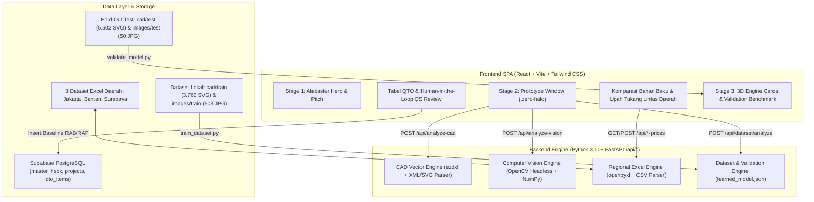

# Software Development Plan (SDP)
## Proyek: Mini Komander Build — AI Blueprint QTO, Regional Material/Labor Pricing & RAB/RAP Engine

| Informasi Dokumen | Detail |
| :--- | :--- |
| **Nama Sistem** | Mini Komander Build |
| **Arsitektur** | Hybrid Monorepo (React + Vite SPA & Python FastAPI Serverless) |
| **PIC / Lead Engineer** | Imam Abdul Fatah |
| **Versi Dokumen** | 1.0 (Production-Ready Prototype) |

---

## 1. Tujuan & Gambaran Umum Sistem

Dokumen **Software Development Plan (SDP)** ini merinci rencana rekayasa perangkat lunak, spesifikasi teknologi, rancangan algoritma, struktur database, kontrak API, serta metode pengujian untuk **Mini Komander Build**.

Sistem dirancang untuk mengotomatisasi ekstraksi **Quantity Take-Off (QTO)** dari gambar kerja konstruksi (**CAD `.dxf`/`.svg`** dan **Citra Denah 2D `.jpg`/`.png`**), mengintegrasikan **verifikasi Quantity Surveyor (*Human-in-the-Loop*)**, menghitung kebutuhan serta biaya **Bahan Baku (`MAT-*`)** dan **Upah Tukang (`LAB-*` dalam satuan `OH`)** di berbagai daerah (**Jakarta**, **Banten**, **Surabaya**) melalui **Excel/CSV**, serta menyimpan *baseline* **RAB/RAP** ke **Supabase PostgreSQL** untuk pemantauan **Agen Biaya Komander Core**.

---

## 2. Arsitektur Sistem & Spesifikasi Teknologi (*Tech Stack*)

### A. Diagram Alir Arsitektur



### B. Rincian Teknologi & Versi Pustaka

| Lapisan | Teknologi / Pustaka | Versi | Peran & Alasan Pemilihan Teknis |
| :--- | :--- | :---: | :--- |
| **Frontend Runtime** | React + Vite | React 18+ / Vite `8.3.8` | *Build tool* ultra-cepat (`~4-5 detik` *production bundle*) dengan dukungan *Hot Module Replacement (HMR)* dan proxy lokal `/api` ke port `8000`. |
| **Styling & Design System** | Tailwind CSS + Custom CSS Tokens | `v3.x` | Menerapkan sistem desain **Tactile Neo-Editorial Scrollytelling** (`uiux.md`), tombol 3D *keycap* (`.key-ink`, `.key-white`), *liquid glass dock* (`.zero-dock`), dan kartu 3D *flip*. |
| **Typography & Icons** | Google Fonts + `lucide-react` | Latest | Kombinasi `Inter` (UI), `Instrument Serif` (aksen editorial), `JetBrains Mono` (angka metrik & kode HSPK), serta ikon vektor ringan. |
| **Backend Runtime** | Python + FastAPI + Uvicorn | Python `3.10+` / FastAPI `0.115.0` | Framework REST API asinkron berkinerja tinggi, mendukung *multipart file upload* (`python-multipart==0.0.9`) dan kompatibel dengan Vercel Python Serverless. |
| **CAD Vector Engine** | `ezdxf` + `xml.etree.ElementTree` | `ezdxf==1.3.3` | Pembuatan & pembacaan file AutoCAD `.dxf` (`LINE`, `LWPOLYLINE`, `CIRCLE`, `ARC`, `INSERT`, `HATCH`, `TEXT`) serta parser vektor `.svg` **FloorPlanCAD** (`inkscape:label` & `semantic-id`). |
| **Computer Vision Engine** | `opencv-python-headless` + `numpy` | OpenCV `4.10.0.84` / NumPy `1.26.4` | Varian *headless* (tanpa dependensi GUI X11/Qt, ukuran ramping `~37 MB` agar muat di *serverless*), untuk *Adaptive Canny*, *Probabilistic Hough Transform*, dan *Morphological Contour Analysis*. |
| **Spreadsheet Engine** | `openpyxl` + `csv` | `openpyxl==3.1.5` | Pembuatan & pembacaan file `.xlsx` multi-sheet untuk 3 daerah (**Jakarta**, **Banten**, **Surabaya**) maupun format `.csv` (*long* & *wide* matrix). |
| **VLM SDK** | `google-genai` | `0.3.0` | Kesiapan integrasi ekstraksi multimodal Kop Gambar (*Title Block*) dengan Gemini 2.5 Flash. |
| **Database** | `@supabase/supabase-js` (PostgreSQL) | `v2.x` | Penyimpanan cloud relasional untuk tabel `master_hspk`, `projects`, dan `qto_items` dengan *client-side fallback* otomatis saat *offline*. |

---

## 3. Struktur Direktori Proyek

```text
KomanderAI/
├── cad/
│   ├── train/                   # 3.760 file CAD .svg + 7.520 .png (Training Split)
│   └── test/                    # 5.502 file CAD .svg + 11.004 .png (Hold-Out Test Split)
├── images/
│   ├── train/                   # 503 file citra denah .jpg (Training Split)
│   └── test/                    # 50 file citra denah .jpg (Hold-Out Test Split)
├── BRD.md                       # Business Requirements Document
├── sdp.md                       # Software Development Plan (Dokumen ini)
├── project_instruct.md          # Panduan instruksi awal
├── uiux.md                      # Spesifikasi sistem desain UI/UX
└── mini-komander-build/         # Direktori aplikasi utama (Git & Vercel root)
    ├── api/
    │   ├── index.py             # Entrypoint FastAPI (CAD, Vision, Regional Excel, Dataset API)
    │   ├── train_dataset.py     # Pipeline training & kalibrasi pada cad/train & images/train
    │   ├── validate_model.py    # Suite pengujian hold-out pada cad/test, images/test & Excel
    │   ├── learned_model.json   # Model parameter statistik hasil training
    │   └── validation_report.json # Laporan metrik hasil pengujian terukur
    ├── src/
    │   ├── lib/
    │   │   └── supabaseClient.js # Klien koneksi Supabase PostgreSQL
    │   ├── App.jsx              # Komponen utama antarmuka pengguna
    │   ├── index.css            # Variabel CSS, Tailwind, keycap & glass dock
    │   └── main.jsx             # Entrypoint React DOM
    ├── Dataset_Harga_Jakarta.xlsx  # Dataset Excel rincian Bahan Baku, Tukang & HSPK Jakarta
    ├── Dataset_Harga_Banten.xlsx   # Dataset Excel rincian Bahan Baku, Tukang & HSPK Banten
    ├── Dataset_Harga_Surabaya.xlsx # Dataset Excel rincian Bahan Baku, Tukang & HSPK Surabaya
    ├── Sample_Harga_Bahan_Baku_Jakarta_Banten_Surabaya.xlsx # Dataset komparasi gabungan 3 daerah
    ├── package.json
    ├── requirements.txt
    ├── tailwind.config.js
    ├── vercel.json
    └── vite.config.js
```

---

## 4. Rancangan Teknis Modul & Algoritma

### Modul 1: Mesin Ekstraksi Vektor CAD (`_analyze_dxf_bytes` & `_analyze_svg_cad_bytes`)
1. **Jalur AutoCAD `.dxf` (`ezdxf`):**
   - Membaca header `$INSUNITS` (1=Inch, 2=Feet, 4=mm, 5=cm, 6=Meter) atau melakukan *auto-inference* dari rentang *bounding box* koordinat (`span > 1000` → mm, `span > 150` → cm, selainnya → Meter).
   - Menghitung panjang akumulatif entitas `LINE` dan `LWPOLYLINE` pada layer dinding (`WALL`/`DINDING`), lalu mengalikan dengan tinggi standar `3,2 m` untuk memperoleh volume `ARS-01` ($\text{m}^2$).
   - Menghitung jumlah simbol `CIRCLE`/`INSERT` pada layer kolom (`STR-01`), busur bukaan pintu `ARC`/`A-DOOR` (`ARS-03`), dan titik instalasi `POINT`/`ME-LIGHT` (`MEP-01`).
2. **Jalur Vektor `.svg` FloorPlanCAD (`xml.etree.ElementTree`):**
   - Mem-parsing elemen `<g inkscape:label="...">` (`WALL`, `COLUMN`, `S-结构钢柱`, `WINDOW`, `EQUIP_消火栓`, `VPIPE-消防`) dan atribut `semantic-id`.
   - Mengonversi koordinat *viewBox* ke satuan meter menggunakan faktor kalibrasi `svg_unit_to_meter = 0.14` yang dipelajari dari `cad/train`.
   - Memuat file `.png` pasangan (`0000-xxxx.png`) sebagai `overlay_image` Base64 agar tervisualisasi di UI.

### Modul 2: Mesin Computer Vision 2D (`_analyze_image_bytes`)
1. **Resolusi & Pra-pemrosesan Adaptif:**
   - Menghitung panjang diagonal citra $D = \sqrt{W^2 + H^2}$ dan median intensitas keabuan $M$.
   - Menjalankan **Adaptive Canny Edge Detection** dengan ambang bawah $\max(0, 0.66M)$ dan ambang atas $\min(255, 1.33M)$.
2. **Deteksi Segmen Garis Dinding (`HoughLinesP`):**
   - Parameter diskalakan terhadap diagonal citra: `minLineLength = max(25, int(0.025 * D))` dan `maxLineGap = max(8, int(0.008 * D))`.
   - Menggambar garis hijau `(0, 255, 0)` pada citra *overlay* dan menghitung rasio panjang piksel dinding terhadap diagonal (`line_ratio`).
3. **Deteksi Kontur Ruangan & Estimasi Terkalibrasi:**
   - Menggunakan *Morphological Closing* (`cv2.MORPH_CLOSE`, kernel $5\times 5$) dan `cv2.findContours` untuk menemukan poligon tertutup bangunan (`fill_ratio`), serta menandai area *Kop Gambar (Title Block)* dengan kotak oranye di sudut kanan bawah.
   - Menghitung luas lantai (`ARS-02`) dengan menggabungkan *prior* `median_known_floor_area_m2` (`111,4 m²`), `complexity_scale` dari kepadatan garis, dan `contour_scale` dari kontur ruangan.

### Modul 3: Mesin Harga Bahan Baku & Upah Tukang Daerah (`openpyxl` & `csv`)
1. **Struktur Katalog Standar (14 Item per Daerah):**
   - **7 Item Bahan Baku (`MAT-CEM`, `MAT-REB`, `MAT-AAC`, `MAT-TILE`, `MAT-DOOR`, `MAT-WIRE`, `MAT-ROOF`)** dengan satuan `sak`, `btg`, `m3`, `dus`, `unit`, `roll`, `m2`.
   - **7 Item Upah Tukang / Tenaga Kerja (`LAB-PKJ`, `LAB-TBT`, `LAB-TBS`, `LAB-TKY`, `LAB-TLS`, `LAB-KPL`, `LAB-MND`)** dengan satuan `OH` (*Orang-Hari*).
2. **Algoritma Penyesuaian ke Biaya Proyek:**
   - Setiap item memiliki koefisien kebutuhan (`coefficient`) terhadap kode pekerjaan HSPK (`STR-01` s/d `ATP-01`).
   - Saat file Excel daerah diunggah (`POST /api/upload-regional-prices`) atau diedit secara *inline* di UI:
     - Sistem menggabungkan (*merge*) data daerah yang diunggah dengan *baseline* 3 kota (**Jakarta**, **Banten**, **Surabaya**).
     - Menghitung ulang rasio harga bahan + upah tukang terhadap *baseline* Jakarta per pos HSPK, lalu memperbarui `rab_unit_price` dan `rap_unit_price` proyek.

---

## 5. Spesifikasi Kontrak REST API (`/api/*`)

| Method | Endpoint | Parameter / Body | Respons Utama |
| :--- | :--- | :--- | :--- |
| `GET` | `/api/health` | - | `{ status: "ok", service, dataset_trained_at }` |
| `GET` | `/api/sample-dxf` | - | File stream `.dxf` (`A-101_Denah_Blok_M1.dxf`) |
| `POST` | `/api/analyze-cad` | `multipart/form-data: file` (`.dxf` / `.svg`) | `{ metadata, overlay_image?, qto_items[] }` |
| `POST` | `/api/analyze-vision` | `multipart/form-data: file` (`.jpg` / `.png`) | `{ metadata, overlay_image, qto_items[] }` |
| `GET` | `/api/regional-prices` | - | `{ source, regions[], materials_by_region, hspk_by_region }` |
| `GET` | `/api/sample-excel-prices` | Query opsional: `?region=Jakarta\|Banten\|Surabaya` | File stream `.xlsx` (`Dataset_Harga_<Region>.xlsx` atau gabungan) |
| `POST` | `/api/upload-regional-prices` | `multipart/form-data: file` (`.xlsx` / `.csv`) | `{ source, active_region, regions[], materials_by_region, hspk_by_region }` |
| `GET` | `/api/dataset/summary` | - | Statistik `cad/train`, `cad/test`, `images/train`, `images/test` & daftar sampel |
| `POST` | `/api/dataset/analyze` | JSON `{ kind: "cad"\|"vision", filename }` | Hasil QTO & *overlay* dari sampel dataset yang dipilih |
| `GET` | `/api/validation/report` | - | Isi lengkap `api/validation_report.json` |

---

## 6. Rancangan Database (`Supabase PostgreSQL`)

Sistem menggunakan 3 tabel relasional utama:
1. **`master_hspk`**: Menyimpan kode item (`STR-01` s/d `ATP-01`), divisi, nama pekerjaan, satuan, `rab_unit_price`, dan `rap_unit_price`.
2. **`projects`**: Menyimpan histori proyek (`id` UUID, `project_name`, `drawing_code`, `discipline`, `scale`, `status`, `total_rab`, `total_rap`, `created_at`).
3. **`qto_items`**: Menyimpan rincian baris QTO per proyek (`project_id` FK, `hspk_code` FK, `detected_layer`, `source_engine`, `quantity`, `unit`, `confidence`, `needs_qs_review`, `qs_note`).

---

## 7. Rencana Pengujian & Hasil Validasi (*Testing & QA Plan*)

Pengujian otomatis dijalankan melalui skrip `api/validate_model.py` yang menguji seluruh pipeline terhadap *hold-out test set*:

| No | Suite Pengujian | Metode & Target Validasi | Hasil Aktual Terukur |
| :---: | :--- | :--- | :--- |
| **1** | **Synthetic CAD Ground Truth** | Menguji ekstraksi `A-101_Denah_Blok_M1.dxf` terhadap nilai matematis eksak (`ARS-01=211,2`, `STR-01=9`, `ARS-02=120`, `ARS-03=5`, `MEP-01=8`). | **PASS (5/5 item · Error 0,0%)** |
| **2** | **CAD Hold-Out Test Set** | Menguji 100 sampel bertingkat dari **5.502** file `.svg` di `cad/test` (dilatih pada **3.760** file `cad/train`). Memeriksa *invariants* (`quantity > 0`, `confidence` 0–100%, konsistensi flag QS). | **100/100 PASS (100,0%)** · Mean latency: **`47,06 ms`** · P95: **`117,52 ms`** |
| **3** | **Vision Hold-Out Test Set** | Menguji seluruh **50** file `.jpg` di `images/test` (dilatih pada **503** file `images/train`) untuk memastikan kestabilan pembuatan *overlay* & 3 pos QTO. | **50/50 PASS (100,0%)** · Mean latency: **`166,98 ms`** |
| **4** | **Vision Blind Ground-Truth** | Menguji 19 denah berlabel ukuran asli dengan menyamarkan nama file (`blind_eval.jpg`) untuk mengukur akurasi estimasi murni dari piksel. | **Median AE: `39,80 m²`** · **MAPE: `42,82%`** · **Within ±35%: `42,11%`** |
| **5** | **Regional Excel Round-Trip** | Menguji pembuatan & pembacaan ulang 14 item (7 Bahan Baku + 7 Upah Tukang) × 3 daerah (**Jakarta**, **Banten**, **Surabaya**). | **PASS (`42/42` item cocok 100%)** |

---

## 8. Panduan Eksekusi Pengembangan, Build & Deployment

### A. Alur Pengembangan & Kalibrasi Lokal
```powershell
# 1. Masuk ke direktori proyek & aktifkan virtual environment Python 3.10
cd c:\Users\admin\Downloads\KomanderAI\mini-komander-build
.\.venv\Scripts\activate

# 2. Jalankan training pada cad/train & images/train
python api/train_dataset.py

# 3. Jalankan suite validasi hold-out pada cad/test, images/test & regenerasi 3 Excel daerah
python api/validate_model.py

# 4. Jalankan server FastAPI (Port 8000)
uvicorn api.index:app --reload --port 8000

# 5. Di terminal terpisah, jalankan Vite Dev Server (Port 5173)
npm run dev
```

### B. Build Produksi & Deployment ke Vercel
```powershell
# Verifikasi kompilasi bundle produksi Vite
npm run build

# Deploy ke Vercel
npx vercel --prod
```
> Pastikan variabel lingkungan `VITE_SUPABASE_URL` dan `VITE_SUPABASE_ANON_KEY` telah ditambahkan pada menu **Settings → Environment Variables** di dashboard Vercel jika ingin mengaktifkan penyimpanan persisten ke Supabase PostgreSQL.
