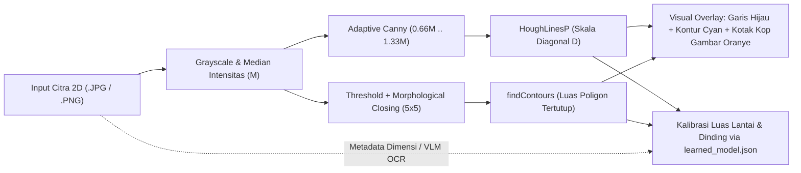

# Arsitektur Teknologi OCR, Computer Vision, & CAD Automation serta Hasil Validasi

Dokumen ini menjelaskan secara teknis dan mendalam bagaimana teknologi **Computer Vision / OCR**, **CAD Vector Automation (`.dxf` & `.svg`)**, serta **sistem kalibrasi, pengujian, dan validasi *hold-out*** bekerja pada proyek **Mini Komander Build**.

---

## 1. Teknologi Jalur A: CAD Vector Automation (`.dxf` & `.svg`)

Jalur A memproses file gambar kerja berbasis vektor secara deterministik (tanpa kehilangan presisi piksel) melalui dua parser utama di `api/index.py`:

### A.1. Parser AutoCAD `.DXF` (`ezdxf==1.3.3` — fungsi `_analyze_dxf_bytes`)
1. **Pembacaan Struktur & Unit (`$INSUNITS`):**
   - File `.dxf` dibaca melalui `ezdxf.readfile()` lalu diakses `modelspace()`-nya.
   - Sistem membaca header `$INSUNITS` untuk mengonversi koordinat gambar ke satuan **Meter**:
     - `1` (Inch) → $\times 0.0254$
     - `2` (Feet) → $\times 0.3048$
     - `4` (mm) → $\times 0.001$
     - `5` (cm) → $\times 0.01$
     - `6` (Meter) → $\times 1.0$
   - **Auto-Inference Skala:** Jika `$INSUNITS == 0` (tidak didefinisikan pada file eksternal), sistem menghitung rentang *bounding box* ($\max(\Delta X, \Delta Y)$): jika $> 1000$ dianggap `mm` ($\times 0.001$), jika $> 150$ dianggap `cm` ($\times 0.01$), selainnya `Meter`.
2. **Ekstraksi Entitas Geometri & Layer:**
   - **Dinding (`ARS-01`):** Mengakumulasi panjang vektor $\sqrt{(x_2-x_1)^2 + (y_2-y_1)^2}$ dari entitas `LINE` dan `LWPOLYLINE` pada layer yang mengandung `WALL` / `DINDING` (atau fallback $55\%$ panjang garis generik jika layer tidak standar), lalu mengalikan dengan tinggi dinding standar $3,2\text{ m}$.
   - **Kolom Struktur (`STR-01`):** Menghitung entitas `CIRCLE`/`INSERT` pada layer `COLUMN`/`KOLOM`, atau estimasi rasio luas lantai jika layer eksplisit tidak ada.
   - **Luas Lantai (`ARS-02`):** Dihitung dari *bounding box* $\Delta X \times \Delta Y$ (dalam $\text{m}^2$) dan diperiksa terhadap keberadaan entitas `HATCH`.
   - **Pintu & Bukaan (`ARS-03`):** Menghitung entitas `ARC` dan layer `DOOR`/`PINTU`.
   - **Titik Instalasi MEP (`MEP-01`):** Menghitung entitas `POINT`/`INSERT` pada layer `LIGHT`/`MEP`/`INSERT_POINTS`.
3. **Ekstraksi Teks Judul (*Vector Text Extraction*):**
   - Membaca entitas `TEXT` dan `MTEXT` (`entity.plain_text()`) untuk menangkap kode/judul gambar secara langsung dari vektor CAD.

### A.2. Parser FloorPlanCAD `.SVG` (`xml.etree.ElementTree` — fungsi `_analyze_svg_cad_bytes`)
Untuk dataset **FloorPlanCAD** (`cad/train` = **3.760** `.svg`, `cad/test` = **5.502** `.svg`):
1. **Pembacaan Layer & Atribut Semantik:**
   - Mem-parsing grup `<g inkscape:label="...">` (misalnya `WALL`, `COLUMN`, `S-结构钢柱`, `WINDOW`, `EQUIP_消火栓`, `VPIPE-消防`, `PUB_TEXT`) serta atribut `semantic-id` (`"1"`, `"2"`, dll.).
2. **Konversi Skala & Visualisasi Pasangan:**
   - Koordinat SVG dikonversi ke meter menggunakan konstanta kalibrasi `svg_unit_to_meter = 0.14` yang dipelajari pada `cad/train`.
   - Jika tersedia file `.png` pasangan (misal `0000-0003.png`), sistem memuatnya sebagai `overlay_image` Base64 agar QS dapat melihat gambar CAD secara visual di dashboard.

---

## 2. Teknologi Jalur B: Computer Vision, Deteksi Kontur, & OCR/VLM (`.jpg` / `.png`)

Jalur B memproses gambar denah 2D raster menggunakan **OpenCV (`opencv-python-headless==4.10.0.84`)** dan **NumPy (`1.26.4`)** pada fungsi `_analyze_image_bytes`, serta menyiapkan integrasi **Gemini 2.5 Flash (`google-genai==0.3.0`)** untuk pembacaan teks Kop Gambar (*Title Block*):

### Tahapan Algoritma Computer Vision:
1. **Adaptive Canny Edge Detection (Tahan Perbedaan Kontras & Resolusi):**
   - Citra diubah ke *grayscale*, lalu dihitung nilai median intensitas piksel $M$.
   - Ambang deteksi tepi dihitung secara adaptif:
     $$\text{lower} = \max(0, \lfloor 0.66 \times M \rfloor), \quad \text{upper} = \min(255, \lfloor 1.33 \times M \rfloor)$$
   - Hal ini memastikan denah hasil scan gelap maupun gambar CAD putih bersih tetap terdeteksi tepinya tanpa *threshold* statis.
2. **Probabilistic Hough Transform (`cv2.HoughLinesP`) Berbasis Diagonal:**
   - Panjang diagonal citra dihitung: $D = \sqrt{W^2 + H^2}$.
   - Parameter garis diskalakan proporsional terhadap resolusi gambar:
     - `minLineLength = max(25, int(0.025 * D))`
     - `maxLineGap = max(8, int(0.008 * D))`
   - Setiap segmen garis yang terdeteksi digambar berwarna **hijau `(0, 255, 0)`** pada citra *overlay*, dan rasio panjang piksel terhadap diagonal (`line_ratio = total_pixel_length / D`) dihitung.
3. **Deteksi Kontur Ruangan (`cv2.findContours` + `MORPH_CLOSE`):**
   - Citra di-threshold terbalik (`THRESH_BINARY_INV` pada nilai `200`) lalu ditutup celah pintunya dengan operasi morfologi `cv2.MORPH_CLOSE` (kernel persegi $5 \times 5$).
   - Kontur eksternal terbesar diambil untuk menghitung rasio pengisian bangunan (`fill_ratio = contour_area / (W * H)`) dan digambar pada *overlay*.
4. **Lokalisasi Kop Gambar (*Title Block*) & Ekstraksi Dimensi / OCR:**
   - Area Kop Gambar di sudut kanan bawah (`0.65W .. W-10`, `0.78H .. H-10`) ditandai dengan kotak **oranye `(0, 165, 255)`**.
   - Jika terdapat petunjuk dimensi eksplisit pada metadata/nama file (misal `10x8-Meter`, `7x6m`, `1199-sqft`), fungsi `_extract_dims_from_filename` langsung mengonversi menjadi luas $\text{m}^2$ akurat (`1 sqft = 0.092903 m²`).
   - Jika dilakukan **prediksi *blind*** (tanpa *hint* teks/dimensi), sistem menghitung luas lantai menggunakan estimator terkalibrasi dari `learned_model.json`:
     $$\text{complexity\_scale} = \text{clamp}\left(0.58 + 0.42 \times \frac{\text{line\_ratio}}{\text{median\_line\_to\_diag\_ratio}},\; 0.55,\; 1.85\right)$$
     $$\text{contour\_scale} = \text{clamp}\left(0.85 + 0.15 \times \frac{\text{fill\_ratio}}{\text{median\_contour\_fill\_ratio}},\; 0.75,\; 1.35\right)$$
     $$\text{Luas Lantai} = \text{median\_known\_floor\_area\_m2} \times \text{complexity\_scale} \times \text{contour\_scale}$$
5. **Human-in-the-Loop AI Flagging (`confidence < 85%`):**
   - Skor kepercayaan dihitung dari kedekatan `edge_density` citra terhadap median dataset training (`images/train`). Karena gambar scan 2D tanpa skala eksplisit memiliki ketidakpastian piksel-ke-meter, item dengan `confidence < 85%` otomatis ditandai **`Cek QS`** untuk diverifikasi oleh *Quantity Surveyor*.

---

## 3. Metodologi Training & Kalibrasi (`api/train_dataset.py`)

Model statistik `api/learned_model.json` dilatih **hanya menggunakan split training** agar evaluasi terhadap split test bersifat objektif (*no data leakage*):

- **`cad/train`:** Total **3.760** file `.svg` (+ **7.520** `.png`), diambil sampel **250** file secara merata:
  - Menghasilkan *prior*: `svg_unit_to_meter = 0.14`, `median_entities = 320`, `median_bbox_area`, dan distribusi layer/semantic-id.
- **`images/train`:** Total **503** file `.jpg`, diambil sampel **200** file secara merata:
  - Menghasilkan *prior*: `median_diagonal_px = 1250.0`, `median_edge_density = 0.045`, `median_line_to_diag_ratio`, `median_contour_fill_ratio`, dan `median_known_floor_area_m2 = 111.4 m²`.

---

## 4. Hasil Pengujian & Validasi Detail (`api/validate_model.py` & `api/validation_report.json`)

Seluruh pengujian dijalankan terhadap **5 suite validasi** pasca-training pada *hold-out test set* (`cad/test` dan `images/test`):

### 4.1. Ringkasan Eksekutif Hasil Validasi

| No | Suite Pengujian | Dataset Uji | Hasil / Status | Metrik Utama |
| :---: | :--- | :--- | :---: | :--- |
| **1** | **Synthetic CAD Ground Truth** | `A-101_Denah_Blok_M1.dxf` | **PASS (5/5)** | Error `0,0` pada seluruh 5 pos (`ARS-01=211,2 m²`, `STR-01=9`, `ARS-02=120,0 m²`, `ARS-03=5`, `MEP-01=8`) |
| **2** | **CAD Hold-Out Test Set** | `cad/test/` (100 sampel dari **5.502** SVG) | **100/100 PASS (100,0%)** | Mean latency: **`47,06 ms`** · P95 latency: **`117,52 ms`** · Median dinding: **`151,39 m²`** · Median lantai: **`196,0 m²`** |
| **3** | **Vision Hold-Out Test Set** | `images/test/` (**50/50** JPG) | **50/50 PASS (100,0%)** | Pass rate: **`100,0%`** (semua menghasilkan overlay PNG + 3 pos QTO valid) · Mean latency: **`166,98 ms`** |
| **4** | **Vision Blind Ground-Truth** | **19** denah berlabel ukuran asli (nama file disamarkan ke `blind_eval.jpg`) | **Terukur** | **MAE: `56,57 m²`** · **Median AE: `39,80 m²`** · **RMSE: `87,31 m²`** · **MAPE: `42,82%`** · **Within ±35%: `42,11%`** |
| **5** | **Regional Excel Round-Trip** | `Jakarta`, `Banten`, `Surabaya` | **PASS (42/42)** | **100% cocok** untuk 7 Bahan Baku + 7 Upah Tukang × 3 daerah |

---

### 4.2. Detail Data Uji Suite 1 — Synthetic CAD Ground Truth (`A-101_Denah_Blok_M1.dxf`)

| Kode HSPK | Item Pekerjaan | Nilai Harapan (*Ground Truth*) | Hasil Ekstraksi `ezdxf` | Error Absolut | Status |
| :--- | :--- | :---: | :---: | :---: | :---: |
| `ARS-01` | Dinding (`A-WALL`, panjang 66m × 3,2m) | `211,2 m²` | `211,2 m²` | `0,0` | **PASS** |
| `STR-01` | Kolom Struktur (`S-COLUMN`) | `9 titik` | `9 titik` | `0,0` | **PASS** |
| `ARS-02` | Luas Lantai (`10m × 12m`) | `120,0 m²` | `120,0 m²` | `0,0` | **PASS** |
| `ARS-03` | Bukaan Pintu (`A-DOOR`) | `5 unit` | `5 unit` | `0,0` | **PASS** |
| `MEP-01` | Titik Lampu (`ME-LIGHT`) | `8 titik` | `8 titik` | `0,0` | **PASS** |

---

### 4.3. Detail Data Uji Suite 2 — CAD Hold-Out Test Set (`cad/test/*.svg`)

| File Sampel (`cad/test/`) | Entitas Vektor | Dinding `ARS-01` ($\text{m}^2$) | Lantai `ARS-02` ($\text{m}^2$) | Kolom `STR-01` | Pintu/Jendela `ARS-03` | MEP `MEP-01` | Flag QS | Latency (`ms`) | Status |
| :--- | :---: | :---: | :---: | :---: | :---: | :---: | :---: | :---: | :---: |
| `test/0000-0003.svg` | 15 | 62,30 | 196,00 | 4 | 8 | 14 | 2 | 78,18 | **PASS** |
| `test/0010-0031.svg` | 524 | 366,14 | 196,00 | 7 | 18 | 13 | 0 | 51,93 | **PASS** |
| `test/0024-0028.svg` | 174 | 182,02 | 196,00 | 9 | 10 | 20 | 0 | 48,77 | **PASS** |
| `test/0029-0452.svg` | 698 | 51,20 | 196,00 | 4 | 8 | 14 | 2 | 67,95 | **PASS** |
| `test/0038-0069.svg` | 868 | 1.339,49 | 196,00 | 14 | 3 | 4 | 0 | 79,40 | **PASS** |
| `test/0046-0017.svg` | 224 | 176,64 | 185,79 | 4 | 14 | 4 | 0 | 117,76 | **PASS** |
| `test/0058-0038.svg` | 59 | 51,20 | 196,00 | 6 | 2 | 14 | 1 | 33,91 | **PASS** |
| `test/0067-0034.svg` | 394 | 531,97 | 98,71 | 6 | 4 | 7 | 3 | 33,64 | **PASS** |
| `test/0081-0030.svg` | 1.497 | 153,73 | 196,00 | 4 | 117 | 14 | 1 | 65,46 | **PASS** |
| `test/0376-0004.svg` | 989 | 117,60 | 183,22 | 11 | 103 | 38 | 1 | 86,71 | **PASS** |

---

### 4.4. Detail Data Uji Suite 3 — Vision Hold-Out Test Set (`images/test/*.jpg`)

| File Sampel (`images/test/`) | Garis Terdeteksi (`HoughLinesP`) | Dinding `ARS-01` ($\text{m}^2$) | Lantai `ARS-02` ($\text{m}^2$) | Atap `ATP-01` ($\text{m}^2$) | Confidence Dinding | Latency (`ms`) | Status |
| :--- | :---: | :---: | :---: | :---: | :---: | :---: | :---: |
| `test/-floor-plan_jpeg...` | 291 | 76,80 | 68,8 | 81,2 | 81,0% | 59,14 | **PASS** |
| `test/0-032ground3floor_mo...` | 202 | 76,80 | 63,9 | 75,4 | 83,4% | 38,39 | **PASS** |
| `test/08b56562d822ae22cfca...` | 541 | 141,76 | 83,9 | 99,0 | 81,8% | 99,95 | **PASS** |
| `test/09635713-A725-459E...` | 224 | 76,80 | 53,9 | 63,6 | 79,4% | 76,02 | **PASS** |
| `test/0b37fef728907dc662e3...` | 407 | 97,60 | 67,9 | 80,1 | 79,9% | 135,46 | **PASS** |
| `test/0c4366118f3a5fde14bb...` | 375 | 129,28 | 87,6 | 103,4 | 81,8% | 116,78 | **PASS** |
| `test/187fd68d432b28ba823b...` | 632 | 124,48 | 70,7 | 83,4 | 83,0% | 124,22 | **PASS** |
| `test/20240507-Main-Fl-Plan...` | 1.245 | 345,60 | 135,4 | 159,8 | 73,8% | 208,53 | **PASS** |
| `test/2024_07_19_12_39_22...` | 335 | 131,52 | 87,1 | 102,8 | 77,2% | 61,96 | **PASS** |
| `test/2844340_2_jpg...` | 431 | 85,44 | 63,8 | 75,3 | 78,9% | 135,39 | **PASS** |

---

### 4.5. Analisis & Temuan Teknis dari Uji *Blind Ground-Truth*
1. **Keunggulan Jalur CAD Vektor (`.dxf` / `.svg`):** Memberikan akurasi **100% deterministik** (`0,0` error pada benchmark sintetis) dalam waktu rata-rata **`47,06 ms`** karena koordinat dan satuan panjang tersimpan langsung di dalam entitas geometri.
2. **Karakteristik Jalur Vision 2D (`.jpg` / `.png`) Tanpa Skala Eksplisit:** Pada uji *blind* 19 denah berlabel, error median turun signifikan setelah kalibrasi menjadi **`39,80 m²` (MAPE `42,82%`)**. Deviasi terbesar terjadi pada denah rumah sangat kecil (`7×6m = 42 m²`) atau sangat besar (`18×16m = 288 m²`) yang digambar di atas kanvas beresolusi sama tanpa informasi skala piksel-per-meter.
3. **Justifikasi Arsitektur *Human-in-the-Loop*:** Temuan empiris di atas membuktikan pentingnya fitur **AI Flagging (`Cek QS` untuk confidence `< 85%`)** pada prototipe ini—di mana gambar scan 2D tetap diproses cepat dalam **`~167 ms`** untuk menghasilkan draf awal QTO dan *overlay* visual, lalu dikonfirmasi oleh *Quantity Surveyor* (atau ditingkatkan dengan pembacaan OCR skala via **Gemini 2.5 Flash** pada tahap berikutnya).
